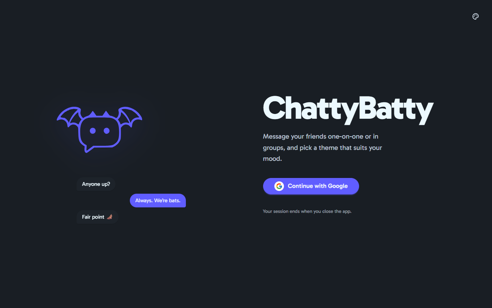
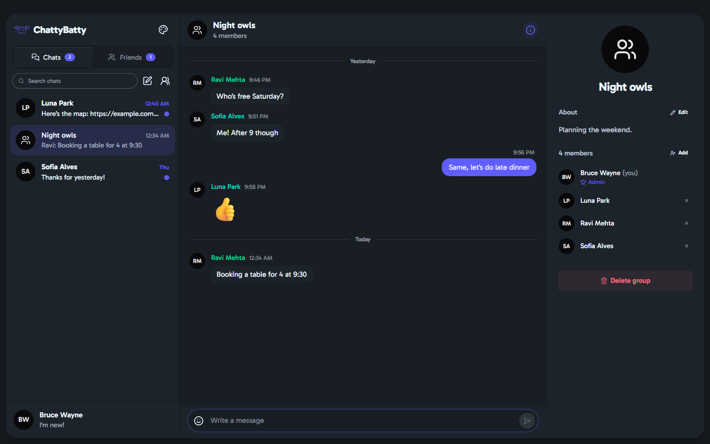
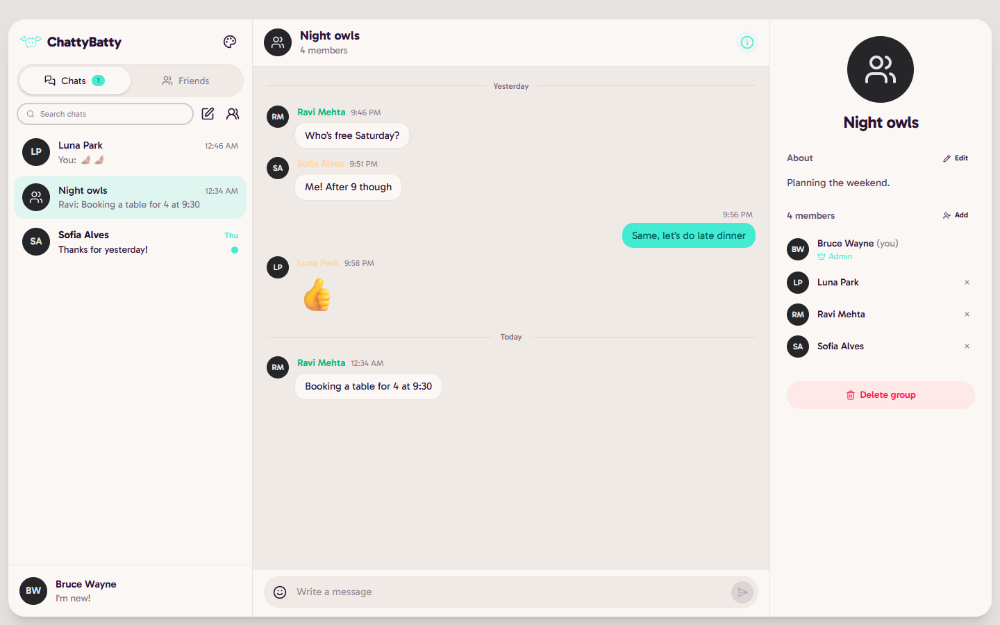
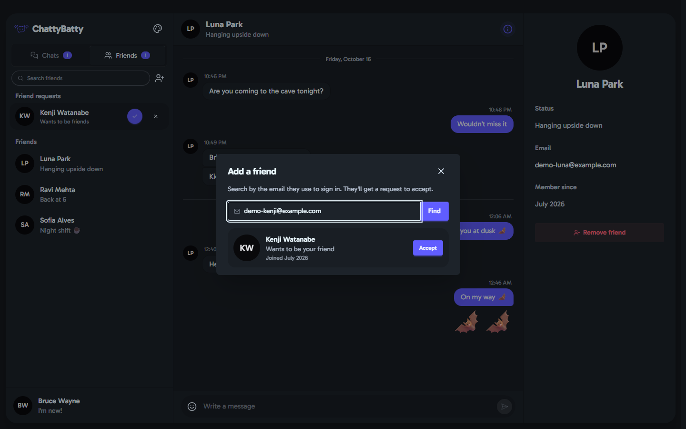
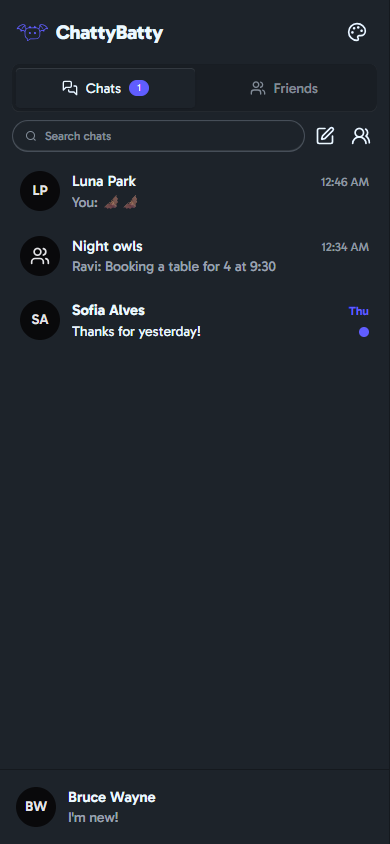
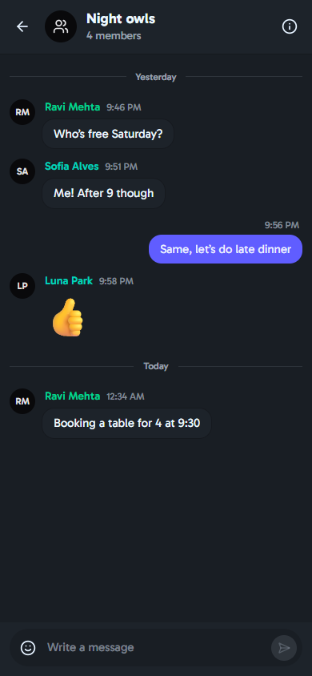

<div align="center">

# ChattyBatty

**A real-time messaging app for chatting with friends, one-on-one or in groups.**

Built with React 19, Tailwind CSS 4 + daisyUI 5, and Firebase (Google sign-in and Cloud Firestore).



</div>

## Contents

- [Features](#features)
- [Screenshots](#screenshots)
- [Tech stack](#tech-stack)
- [Getting started](#getting-started)
  - [Option A: Try it locally, no setup](#option-a-try-it-locally-no-setup)
  - [Option B: Real Google sign-in with your Firebase project](#option-b-real-google-sign-in-with-your-firebase-project)
- [Using the app](#using-the-app)
- [Chatting across different computers](#chatting-across-different-computers)
- [Security](#security)
- [Scripts](#scripts)
- [Project structure](#project-structure)
- [Troubleshooting](#troubleshooting)
- [Known limitations](#known-limitations)

## Features

**Messaging**

- Direct messages and group chats that update live, with no refresh needed
- Messages grouped by sender, day separators, clickable links, and large emoji-only messages
- Emoji picker, and Enter to send (Shift+Enter for a new line)
- Unsent drafts are kept when you switch between chats
- Older messages load as you scroll up; a **New messages** button appears if something arrives while you're reading history

**Knowing what's new**

- Unread dots in the chat list and an unread count in the window title
- **Seen** under your last message once the other person has read it (direct chats)

**Friends**

- Find people by the email they sign in with and send a friend request
- Accept or decline incoming requests; remove friends at any time

**Groups**

- Create a group with a name, description and members chosen from your friends
- The group admin can rename it, edit the description, add or remove members, and delete it along with all of its messages
- Other members can leave

**Look and feel**

- 14 themes, light and dark, remembered between sessions
- Works on desktop, tablet and phone: three panes on wide screens, one at a time on phones
- Keyboard accessible, with confirmation before anything destructive

## Screenshots

| Group chat                                                       | Light theme                                                   |
| ---------------------------------------------------------------- | ------------------------------------------------------------- |
|  |  |

| Adding a friend                                                     | On a phone                                                                                                  |
| ------------------------------------------------------------------- | ----------------------------------------------------------------------------------------------------------- |
|  |   |

## Tech stack

| Area     | Tools                                                                   |
| -------- | ----------------------------------------------------------------------- |
| UI       | React 19, Vite 6, Tailwind CSS 4, daisyUI 5, react-icons, Gabarito font |
| Data     | Cloud Firestore with real-time listeners (`react-firebase-hooks`)       |
| Auth     | Firebase Authentication, Google provider                                |
| Security | Firestore security rules, tested against the emulator with Vitest       |
| Tooling  | ESLint, Prettier, Firebase CLI and emulators                            |

## Getting started

### Prerequisites

- [Node.js](https://nodejs.org) 20 or newer
- [Java](https://adoptium.net) 11 or newer, needed only for the local emulators (Option A) and the rule tests
- A Google account, needed only for real sign-in (Option B)

Clone the repo and install dependencies:

```bash
git clone https://github.com/phemelomakgopa/Messaging-App.git
cd Messaging-App/ChattyBatty
npm install
```

All commands below are run from the `ChattyBatty` folder.

### Option A: Try it locally, no setup

This runs everything on your computer using the Firebase emulators. No Firebase account is needed, and sign-in uses a **stand-in Google screen** where you can pick or invent any account. The app shows a "Test mode" notice so you know.

```bash
# Terminal 1: start the local Auth and Firestore emulators (leave running)
npm run emulators

# Terminal 2: start the app against the emulators
npm run dev:emulators
```

Open **http://localhost:5173**, click **Continue with Google**, then **Add new account** and enter any email.

To fill the app with demo friends, chats and messages, run this in a third terminal with the email you just used:

```bash
npm run seed -- you@example.com
```

Emulator data is wiped when you stop the emulators.

### Option B: Real Google sign-in with your Firebase project

**1. Create a Firebase project** (skip if you already have one) at [console.firebase.google.com](https://console.firebase.google.com). The free Spark plan is enough.

**2. Log in to the Firebase CLI.** This opens your browser:

```bash
npx firebase login
```

**3. Run the setup script:**

```bash
npm run setup
```

It asks which project to use, then:

- registers a web app in the project (or reuses an existing one) and writes its config to `.env`
- creates the Firestore database if there isn't one (you choose the location, e.g. `nam5` for the US, `eur3` for Europe, `africa-south1` for Johannesburg)
- saves the project in `.firebaserc` and deploys the security rules

**4. Turn on Google sign-in.** This is the one step the CLI can't do. In the Firebase console go to **Authentication → Sign-in method**, click **Get started** if asked, then **Google → Enable**, pick a support email and **Save**. The setup script prints a direct link.

**5. Start the app:**

```bash
npm run dev
```

Open **http://localhost:5173** and sign in with your Google account.

<details>
<summary>Prefer to set it up by hand?</summary>

1. In the Firebase console, open **Project settings → Your apps**, add a **Web app**, and copy its config.
2. Copy `.env.example` to `.env` and fill in the values:
   ```bash
   cp .env.example .env      # Windows: copy .env.example .env
   ```
3. Create a **Firestore Database** (Build → Firestore Database → Create database).
4. Enable **Authentication → Sign-in method → Google**.
5. Deploy the rules:
   ```bash
   npx firebase use --add    # pick your project
   npm run deploy:rules
   ```

</details>

> The values in `.env` aren't secret: Firebase web config always ships to the browser. What protects your data is the security rules, so make sure they're deployed.

## Using the app

1. **Add a friend.** Open the **Friends** tab, click the add-person icon and search for their email. They need to have signed in at least once. Click **Send request**.
2. **Accept requests.** Incoming requests appear at the top of the Friends tab. Click ✓ to accept or ✕ to decline.
3. **Start a chat.** Click a friend in the Friends tab, or use the pencil icon in the Chats tab.
4. **Make a group.** Use the people icon in the Chats tab, give it a name and pick members.
5. **See details.** The ⓘ button in a chat opens the details panel: the person's status and email, or the group's members and admin tools.
6. **Change your status or sign out.** Click your name at the bottom of the sidebar.
7. **Change the theme.** Use the palette icon at the top of the sidebar.

Sign-ins last for the browser tab: closing the tab or window signs you out.

## Chatting across different computers

Messages go through Firebase, so any devices using the **same Firebase project** (Option B) can chat with each other in real time. The emulators in Option A only exist on one computer.

- **Each person runs the app:** clone the repo on each computer, put the same `.env` in `ChattyBatty/`, and run `npm run dev`. `localhost` is allowed to sign in by default.
- **One computer serves it to others on the network:** run `npm run dev -- --host` and open `http://<that computer's IP>:5173` on the others. Add that IP under **Authentication → Settings → Authorized domains** first, or Google sign-in will be refused.
- **Testing alone:** two browser windows (for example, a normal and a private window) can be signed in as two different Google accounts at once.

## Security

Access control lives in [`ChattyBatty/firestore.rules`](ChattyBatty/firestore.rules) and is covered by 32 tests in [`ChattyBatty/tests`](ChattyBatty/tests).

- **Profiles:** signed-in users can look up one profile at a time; the user directory can't be listed or dumped. You can only edit your own profile, and your email can't be changed.
- **Friends:** friendships need both people. You can only add _yourself_ to someone's requests, and only become their friend once they've accepted.
- **Chats:** only participants can read a chat or its messages. New chats can only include your friends, and each pair of people gets exactly one direct chat.
- **Messages:** must come from the signed-in sender, are limited to 2,000 characters, and can't be edited afterwards.
- **Groups:** only the admin can rename a group, change its members or delete it. Members can leave.

Run the tests (needs Java, and the emulators must not already be running):

```bash
npm run test:rules
```

> **Upgrading from an earlier version of ChattyBatty?** Older builds write data in ways these rules refuse (for example, adding friends without a request). Deploy the new rules and the new app together. Existing users, friendships and chats keep working.

## Scripts

| Command                 | What it does                                                                   |
| ----------------------- | ------------------------------------------------------------------------------ |
| `npm run setup`         | Connect to a Firebase project: writes `.env`, creates Firestore, deploys rules |
| `npm run dev`           | Start the app against your Firebase project                                    |
| `npm run emulators`     | Start the local Auth and Firestore emulators                                   |
| `npm run dev:emulators` | Start the app against the local emulators                                      |
| `npm run seed -- EMAIL` | Add demo friends, chats and messages to the emulators for that account         |
| `npm run test:rules`    | Test the security rules against the emulator                                   |
| `npm run deploy:rules`  | Deploy the security rules to your Firebase project                             |
| `npm run build`         | Production build into `dist/`                                                  |
| `npm run preview`       | Serve the production build locally                                             |
| `npm run lint`          | Check the code with ESLint                                                     |
| `npm run format`        | Format the code with Prettier                                                  |

## Project structure

```
Messaging-App/
├── Images/                  Screenshots used in this README
└── ChattyBatty/
    ├── src/
    │   ├── components/      UI: sidebar, chat list, conversation, composer, dialogs, details panel
    │   ├── context/         Friends and toast notifications
    │   ├── hooks/           Live user profiles, media queries
    │   ├── lib/             Firestore operations, sign-in, formatting, themes
    │   ├── firebaseConfig.js
    │   └── main.jsx
    ├── tests/               Security rule tests
    ├── scripts/             Firebase setup and emulator seed scripts
    ├── firestore.rules      Security rules
    ├── firebase.json        Firebase CLI and emulator config
    ├── .env.example         Template for your Firebase web config
    └── .env.emulator        Config used by npm run dev:emulators
```

## Troubleshooting

When sign-in fails, the app explains what's wrong and links to the right page in the Firebase console. The common ones:

| You see                                                       | What to do                                                                                                                        |
| ------------------------------------------------------------- | --------------------------------------------------------------------------------------------------------------------------------- |
| **Firebase isn't configured**                                 | There's no `.env`. Run `npx firebase login` then `npm run setup`, or follow the manual steps. Restart `npm run dev` afterwards.   |
| **Google sign-in is turned off for this Firebase project**    | Authentication → Sign-in method → Google → Enable.                                                                                |
| **Authentication isn't set up for this Firebase project yet** | Open Authentication in the console and click **Get started**, then enable Google.                                                 |
| **… isn't allowed to sign in**                                | You're opening the app from a domain or IP that isn't authorised. Add it under Authentication → Settings → Authorized domains.    |
| **The Firebase API key in .env isn't valid**                  | `.env` has the wrong values. Run `npm run setup` again, then restart the dev server.                                              |
| **The sign-in window was blocked**                            | Allow pop-ups for the site. The app also falls back to a full-page redirect where pop-ups can't open.                             |
| A stand-in Google screen with "Auth Emulator"                 | You're in test mode (`npm run dev:emulators`). Use `npm run dev` for real Google accounts.                                        |
| **You don't have permission to do that**                      | The security rules refused the action. If you just set up the project, make sure the rules are deployed (`npm run deploy:rules`). |
| `npm run test:rules` hangs or says the port is taken          | Stop `npm run emulators` first; the tests start their own emulator.                                                               |

## Known limitations

- **Image attachments** aren't supported yet; they'd need Firebase Storage.
- **Email lookup** can still be used to check, one address at a time, whether someone has an account. Closing that fully needs a Cloud Function.
- **Electron:** the app was designed to run in Electron (it has window-drag regions), but the Electron packaging code isn't in this repository. Google sign-in pop-ups don't work from `file://` pages, so a packaged build needs to load the app over `http(s)` from an authorised domain.
- **Firebase 12:** one dependency advisory (in `@grpc/grpc-js`, used by Firebase's Node build, not the browser bundle) is only resolved by upgrading to Firebase 12, a major version.
